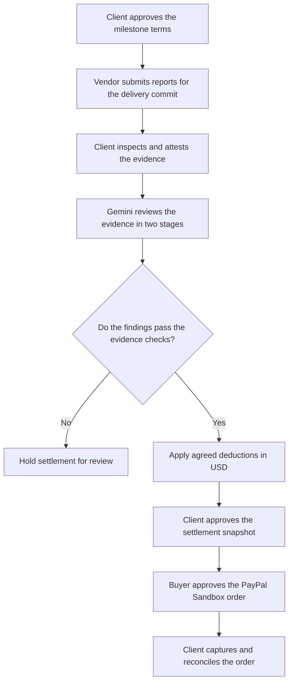

# CovenantX

CovenantX helps a client review a software delivery and explain the amount approved for payment. It ties the agreed milestone terms, the vendor's reports, the review findings and the PayPal Sandbox order to the same record.

## Why use it?

A software milestone may have a fixed price with deductions for missed acceptance criteria. The contract might be in a shared document, the measurements in a CI run and the payment in a separate dashboard. If the client pays less than the agreed price, the vendor has to work out which rule triggered the deduction and which report supports it.

CovenantX is for the point between delivery and payment, when both sides need to review what was delivered against the terms they agreed to. For example, a $5,000 milestone might require at least 85% statement coverage and specify a $500 deduction if that target is missed. If the submitted report shows 78% and all other clauses pass, the proposed amount is $4,500. The client can inspect the report, see the deduction beside the clause and approve that exact amount before checkout.

## How a milestone moves through the app



1. **Agree on the terms.** The client records the milestone amount, delivery commit and acceptance criteria. Each clause has a measurement, comparison, threshold and deduction. Approval locks the contract rules.
2. **Submit and inspect the evidence.** The vendor uploads reports. The API derives measurements and records the file hashes. The client inspects the source and measurements and records an attestation. A file hash identifies the submitted content. The attestation records the client's source check.
3. **Review each clause.** Gemini reads the submitted evidence and returns a finding and a quotation for each clause. A second Gemini call sees those findings and looks for problems. The API checks that each quote occurs in the evidence and that the verdict agrees with the measured value. Missing measurements, stale evidence, a mismatched commit or unresolved concerns can put the proposal on hold.
4. **Approve the amount.** The server calculates the proposed amount in USD by subtracting the approved deductions for failed clauses. Gemini supplies the review findings. The contract rules determine the arithmetic, and the client approves the exact snapshot used for checkout.
5. **Settle in PayPal Sandbox.** CovenantX creates an order for the approved amount. A Sandbox buyer approves it in PayPal. The client then requests capture and reconciliation. The API matches the provider response to the milestone, snapshot and amount before recording completion.

## Evidence the app accepts

| Evidence | Measurement used in the contract |
| --- | --- |
| Coverage.py JSON | Statement coverage calculated from the report's counts |
| k6 custom summary JSON | P95 HTTP request duration from the summary |
| SARIF security report | Count of critical findings from the supported SARIF fields |
| Plain text or Markdown | Presence of a nonempty document. The client reviews its completeness. |

Use the reports that correspond to the approved clauses. A documentation-only contract, for example, only needs its delivery document.

## Reviewing a decision

| Workspace | What you can inspect or do |
| --- | --- |
| Overview | Follow the active milestone and see how deductions affect the proposed payment. |
| Contract & evidence | Set the rules, upload delivery reports and record client attestation. |
| Verification | Compare the two Gemini review stages and expand the exact evidence quotes. |
| Settlement studio | Inspect the amount by clause, try a hypothetical coverage value and approve the stored proposal. |
| CovenantGraph | Follow the links between a clause, its evidence and its finding. |
| Disputes | Raise a dispute and record the vendor's resolution. Settlement requires fresh client approval after resolution. |
| PayPal operations | Create the Sandbox order, open buyer approval, capture and reconcile. |
| Evidence passport | Export the decision record and replay its stored policy calculation. |
| Activity log | Filter or export events by role and inspect recorded state transitions. |

## Technical stack

| Layer | Tools and responsibilities |
| --- | --- |
| Web | Next.js, React and TypeScript for the workspace. TanStack Query handles API reads and polling. |
| API | Python, FastAPI and Pydantic handle role checks, input validation and milestone operations. |
| Storage | SQLAlchemy stores milestones and audit events. SQLite is the default for local use. Docker Compose uses PostgreSQL, with Alembic for schema migrations. |
| Review | The Google GenAI SDK makes two sequential Gemini calls. Python checks citations and applies the contract rules with decimal arithmetic. |
| Payments | PayPal Sandbox Orders API handles approval and capture. Stored request IDs support safe retries, and reconciliation checks the provider's order against the approved snapshot. |

`apps/web/` contains the workspace. `apps/api/` contains the API, evidence parsers, review policy and PayPal adapter. `database/` contains migrations, `scripts/` contains local setup and passport tools, and `demo/` contains the sample contract and reports.

The workspace uses one client token and one vendor token per deployment. Checkout uses the Sandbox merchant tied to the configured PayPal app, and all milestone amounts are in USD.

## Run CovenantX locally

Create a Python virtual environment, install the backend requirements and generate the local `.env` from the repository root:

```bash
python -m venv .venv
source .venv/bin/activate
python -m pip install -r requirements.txt
python scripts/configure_local.py
python scripts/run_api.py
```

Use the [local runbook](docs/LOCAL_RUNBOOK.md) for Windows Command Prompt commands, runtime prerequisites, Sandbox credentials and troubleshooting. Run the web app in a second terminal:

```bash
cd apps/web
npm ci
npm run dev
```

Open [CovenantX](http://localhost:3000) and unlock with the client or vendor token from your local `.env`. The [API health endpoint](http://127.0.0.1:8000/api/health) shows whether the provider settings loaded.

## Try the workflow

Start with the **built-in fixture**. Create and approve the prefilled contract as the client. Switch to the vendor, open **Advanced manual evidence / fixture** and submit the prefilled evidence. Switch back to the client, record an inspection note and attest the sample. In **Verification**, run **Run labeled fixture** and open **Settlement studio**. Expect a $500 deduction and a $4,500 proposal. Fixture decisions are labeled simulated and payment approval is blocked.

For **Gemini and PayPal Sandbox**, use a fresh milestone and genuine evidence from the delivery commit. The [local runbook](docs/LOCAL_RUNBOOK.md#test-gemini-and-paypal-sandbox) walks through a documentation-only milestone using this repository's README, from the evidence upload to a reconciled Sandbox capture.

[Architecture](docs/ARCHITECTURE.md) · [PayPal integration](docs/integrations/PAYPAL_INTEGRATION.md) · [Threat model](docs/security/THREAT_MODEL.md) · [MIT License](LICENSE)
