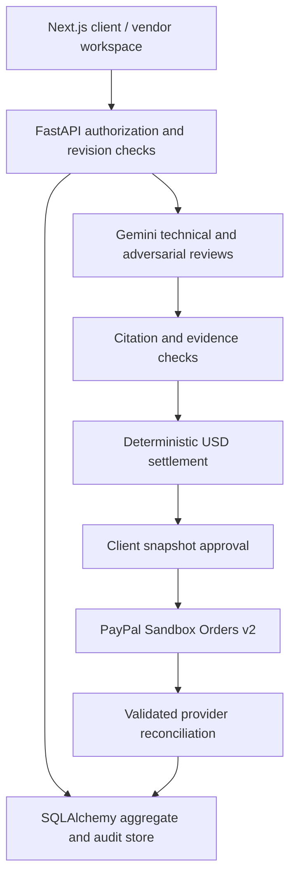

# CovenantX

**Evidence-backed milestone review and PayPal Sandbox settlement.**

CovenantX connects a software delivery decision to the amount a client authorizes for payment. A contract's coverage, latency, security and documentation criteria become explicit rules. A vendor submits evidence; the client attests the source and measurements; reviewers interpret the evidence; a deterministic engine applies the agreed deductions. Payment requires a separate client approval.

This is a working development slice, not a completed production product or a regulated escrow service. **No real Gemini call or PayPal Sandbox transaction was executed during this build.** External adapters are implemented and tested with explicit test doubles. The fixture mode cannot authorize payments.

## Why this exists

Software agencies often keep delivery requirements, CI evidence, acceptance decisions and invoices in separate places. A client may see a failed SLA without knowing which deduction applies, while a vendor may receive a deduction without its supporting evidence. CovenantX keeps those relationships together and makes the final payment traceable to an approved decision snapshot.

## Phase 2 update

Report uploads now derive measurements server-side, draft contracts have a form editor, interrupted payments have a GET-only recovery action, and passports support historical policy replay. See [Phase 2 details](docs/engineering/PHASE_2.md) and [executed checks](docs/evaluations/PHASE_2_TEST_REPORT.md).

## What runs today

- Next.js 15 / TypeScript interface with eight workspaces, role-specific actions, explicit errors and 15-second polling.
- FastAPI API, Pydantic validation and SQLAlchemy persistence. Local SQLite was tested; PostgreSQL configuration and Alembic migration are supplied.
- Immutable contract rules after approval, revision-bound writes and append-only application audit events.
- Contract forms and revision-bound draft editing; advanced JSON remains available. Approved contracts cannot be edited.
- Report upload and server-side parsing for Coverage.py JSON, k6 summary JSON, a bounded SARIF 2.1 subset and text documentation. Original content and derived measurement receipts are preserved. **No PDF parser or GitHub artifact collector yet.**
- Human-attested evidence with commit, age, completeness and hash checks. A URL or hash does not prove source authenticity.
- Two sequential Gemini review stages using the Google GenAI SDK. Model output has no payment tools or authority to alter financial terms.
- Exact citation, unknown-result, reviewer-concern and numerical contradiction gates.
- Decimal USD settlement calculations; coverage counterfactuals do not modify stored decisions.
- A clause/evidence/finding relationship explorer and JSON Evidence Passport with an offline integrity checker, historical policy replay and readable report export.
- Client/vendor dispute handling and fresh client settlement approval after a resolution.
- Sandbox-only PayPal OAuth, order creation, capture, GET reconciliation and provider-verified webhook adapter. Durable request IDs, revision claims and uncertainty locks protect the same payment intent. GET-only recovery validates candidate orders after an interruption.

## Verification status

| Area | Result |
|---|---|
| Python suite | 89 tests passed; raw results and JUnit XML in `docs/evaluations/` |
| Backend statement coverage | 699 / 755 statements (92.58%); not model accuracy or external integration proof |
| Next.js build | Passed with Next.js 15.5.29; TypeScript checks passed |
| SQLite migration | `alembic upgrade head` executed successfully |
| Persistence | Application restart test passed |
| Real local HTTP smoke | Passed: fixture workflow, counterfactual and forbidden-payment check |
| Browser | Desktop login layout rendered and inspected; authenticated browser workflow not exercised |
| Gemini | Adapter implemented; account/model execution blocked by absent credentials |
| PayPal | Adapter and financial workflow tested against doubles; real sandbox workflow unverified |
| PostgreSQL / containers | Configuration supplied; not executed here (Docker unavailable) |
| Hosted application | Not deployed |

Read [submission readiness](docs/submission/SUBMISSION_READINESS.md) before using this in a competition demo.

## Architecture



The runtime is a modular monolith. SQLite is a local convenience; the Compose topology uses PostgreSQL. This release supports **one client/vendor pair per deployment**. It does not implement multi-tenant SaaS isolation, user registration or enterprise identity management.

## Local setup (Windows, macOS or Linux)

Requires Python 3.12 and Node.js 22 or later. From the extracted `covenantx` directory:

```bash
python -m venv .venv
```

Activate it on Windows PowerShell:

```powershell
.venv\Scripts\Activate.ps1
```

Or on macOS/Linux:

```bash
source .venv/bin/activate
```

Then:

```bash
python -m pip install -r requirements.txt
python scripts/configure_local.py
python scripts/run_api.py
```

The configuration script creates distinct random client/vendor tokens and a database password in `.env`. It refuses to overwrite an existing file. Open `.env` locally; use its `CLIENT_TOKEN` or `VENDOR_TOKEN` in the UI. Do not put secrets into chat, screenshots or Git.

In a second terminal:

```bash
cd apps/web
npm ci
npm run dev
```

Open `http://localhost:3000`. API health is `http://localhost:8000/api/health`; the interactive API reference is `http://localhost:8000/docs`.

### Configure real external integrations

Edit `.env` with your authorized **sandbox merchant** client ID and secret, Gemini API key and a model available to your account. `GEMINI_MODEL` is deliberately not guessed: consult Google's current model catalog and your account access. Restart the API after editing.

| Variable | Purpose |
|---|---|
| `CLIENT_TOKEN`, `VENDOR_TOKEN` | Distinct deployment-scoped bearer tokens, at least 32 characters |
| `DATABASE_URL` | SQLite locally; `postgresql+psycopg://...` for PostgreSQL |
| `PUBLIC_WEB_URL` | Exact browser origin; also PayPal return/cancel destination |
| `PAYPAL_CLIENT_ID`, `PAYPAL_CLIENT_SECRET` | Sandbox merchant credentials only |
| `PAYPAL_WEBHOOK_ID` | Required for provider-side webhook verification |
| `GEMINI_API_KEY`, `GEMINI_MODEL` | Actual provider access and enabled model |
| `POSTGRES_PASSWORD` | Compose database password |
| `API_INTERNAL_URL` | Next.js server proxy destination; set before building |

Do not use the client account's real payment credentials. The developer application receives payments into its sandbox merchant account; vendor identity is not a configurable payout destination. There is no custody, escrow, payout splitting or Payouts API integration.

### Docker / PostgreSQL (not executed in this environment)

```bash
python scripts/configure_local.py
# Edit .env as appropriate; skip configure_local.py if it already exists.
docker compose up --build
```

The API runs `alembic upgrade head` before startup. PostgreSQL data lives in the named `database` volume. The browser and API ports are bound to local loopback. The web image builds with `API_INTERNAL_URL=http://api:8000`; rebuild if changing that internal destination. Deploying publicly requires TLS, managed identity, backups and the additional hardening listed in the threat model.

## Reproduce the fixture demonstration

1. Unlock as client. In Contract & evidence, create the sample draft and approve the active contract.
2. Lock the workspace and unlock as vendor. Import the four files from `demo/reports/`, with the same commit SHA and a fixture run reference. Keep **Demonstration data** checked. Alternatively use the advanced manual fixture editor.
3. Unlock as client, inspect the active evidence, add an inspection note and attest it.
4. In Verification, run **labeled fixture**. The sample yields a $500 coverage deduction and a $4,500 proposal. This is deterministic fixture behavior, not an AI result.
5. In Settlement studio, compare coverage at 90%. The hypothetical proposal becomes $5,000 and the stored proposal remains $4,500.
6. Inspect CovenantGraph. In Evidence passport, replay the stored decision, then export it. Try approving settlement: the server rejects fixture/demo payment authorization.

For a real sandbox run, supply your own genuine evidence and contract, complete human source inspection, run Gemini successfully, resolve holds and disputes, approve settlement, create one order, approve on PayPal, capture, then reconcile. See [the detailed runbook](docs/submission/DEMO_RUNBOOK.md).

## Tests and passport verification

For optional coverage measurement, install `requirements-dev.txt` and follow the [Phase 2 test report](docs/evaluations/PHASE_2_TEST_REPORT.md).

```bash
python -m pytest -q
python scripts/http_smoke.py
python -m alembic upgrade head
cd apps/web
npm run build
```

From the repository root:

```bash
python scripts/passport.py downloaded-passport.json --replay --report passport-report.md
```

A matching digest proves consistency with that retained digest. It is not an authenticated signature; someone able to replace both content and digest can forge a different passport.

## Known boundaries

The current implementation has no automated PDF extraction, CI artifact download, independent provenance verification, cryptographic attestation, refund handling, contract amendment workflow, multi-currency settlement, paid infrastructure or deployed background worker. Drafts can be edited; changes after contract approval require a new milestone; avoid creating a replacement while an earlier payment is unresolved. Post-payment disputes need a separate operational/refund process.

An interrupted `CREATING` or `CAPTURING` request remains locked until a client verifies a matching provider order through the recovery action. After a two-minute grace period, recovery GETs a candidate order and validates its original snapshot and amount; it never creates or captures a payment. Unknown creation can retry the same idempotency key for at most five hours. Unknown capture is reconciled by GET, never automatically recaptured. If no provider order can be located, the record stays locked for manual investigation. Rate limiting is local to one API process and is not perimeter DDoS protection. Authenticated browser E2E, PostgreSQL concurrency, and external-service acceptance remain open.

[Architecture](docs/ARCHITECTURE.md) · [Threat model](docs/security/THREAT_MODEL.md) · [Test report](docs/evaluations/TEST_REPORT.md) · [PayPal workflow](docs/integrations/PAYPAL_INTEGRATION.md) · [Engineering audit](docs/engineering/ENGINEERING_AUDIT.md)

MIT licensed. No sponsor usage is claimed merely from documentation research.
