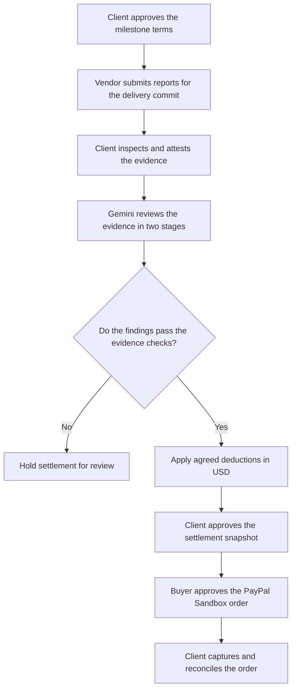

# CovenantX

CovenantX connects software acceptance criteria to a milestone payment. A client agrees on delivery rules, a vendor submits the reports, and Gemini reviews the evidence. The server applies the agreed deductions and prepares an amount for the client to approve through PayPal Sandbox.

## The problem

A failed acceptance check has a financial consequence only if the contract says what that consequence is. In practice, the terms, test reports and payment record often sit in different places. Working out a deduction means finding the right report, checking which delivery it belongs to and matching the result to the original agreement.

CovenantX keeps those records together. Each finding points to a contract clause and a quotation from the submitted evidence. Each payment refers to the settlement snapshot the client approved.

It's intended for software delivery milestones with measurable acceptance criteria, such as coverage targets, response-time limits, security findings or required documentation. The client and vendor agree on the rules before the delivery is reviewed.

## A worked example

Suppose a milestone is worth $5,000. Its contract requires at least 85% statement coverage, with a $500 deduction for falling below that threshold.

The vendor submits a report showing 78%. The client checks the report's source and commit, then requests a review. If the remaining clauses pass and the evidence checks clear, CovenantX proposes $4,500. The client can open the coverage finding, inspect the supporting text and approve the amount before creating a PayPal Sandbox order.

## How a milestone moves through the app



The workflow has three approval points. The client first approves the contract, then attests the submitted evidence, and finally approves the settlement amount. These are separate actions because they answer different questions: what was agreed, what was delivered and what should be paid.

### Contract and evidence

Each contract clause defines a metric, comparison, threshold and deduction. Approval freezes those rules. Reports are associated with the delivery commit, and the API stores their content, hashes and parsed measurements.

The client records how they inspected the source and measurements. Hashes let the application identify the submitted content. Source inspection depends on the client's attestation.

### Gemini review

The first Gemini call assesses the evidence against the clauses. The second receives that assessment and checks it for unsupported conclusions or contradictions. Both stages use the configured model, and their findings and quotations are available in the Verification workspace.

The API checks that every approved clause has a finding, that each quotation occurs in the evidence and that the verdict agrees with the supplied measurement. It also checks the delivery commit, report age and required measurements. An unresolved concern or failed check puts the proposal on hold.

### Settlement and checkout

For each failed clause, the server subtracts the deduction written into the approved contract. Calculations use decimal arithmetic in USD. The client reviews the result and approves a snapshot tying the contract, evidence and decision to the payment.

CovenantX uses that amount to create a PayPal Sandbox order. After the buyer approves it in PayPal, the client requests capture and reconciliation. The API checks the returned order, currency, amount and snapshot reference before recording completion. Stored request IDs and payment states control retries when a response is interrupted.

## Evidence the app accepts

| Evidence | Measurement used in the contract |
| --- | --- |
| Coverage.py JSON | Statement coverage calculated from the report's counts |
| k6 custom summary JSON | P95 HTTP request duration from the summary |
| SARIF security report | Count of critical findings from the supported SARIF fields |
| Plain text or Markdown | Presence of a nonempty document. The client reviews its completeness. |

The contract determines which measurements are required. A milestone with a single documentation clause can be reviewed using its delivery document alone.

## Workspace

| Workspace | What you can inspect or do |
| --- | --- |
| Overview | Follow the active milestone and see how deductions affect the proposed payment. |
| Contract & evidence | Set the rules, upload delivery reports and record client attestation. |
| Verification | Compare the two Gemini review stages and expand the exact evidence quotes. |
| Settlement studio | Inspect the amount by clause, try a hypothetical coverage value and approve the stored proposal. |
| CovenantGraph | Follow the links between a clause, its evidence and its finding. |
| Disputes | Raise a dispute and record the vendor's resolution. Settlement requires fresh client approval after resolution. |
| PayPal operations | Create the Sandbox order, open buyer approval, capture and reconcile. |
| Evidence passport | Export the decision record and replay its stored policy calculation. |
| Activity log | Filter or export events by role and inspect recorded state transitions. |

## Stack

| Layer | Tools and responsibilities |
| --- | --- |
| Web | Next.js, React and TypeScript for the workspace. TanStack Query handles API reads and polling. |
| API | Python, FastAPI and Pydantic handle role checks, input validation and milestone operations. |
| Storage | SQLAlchemy stores milestones and audit events. SQLite is the default for local use. Docker Compose uses PostgreSQL, with Alembic for schema migrations. |
| Review | The Google GenAI SDK makes two sequential Gemini calls. Python checks citations and applies the contract rules with decimal arithmetic. |
| Payments | PayPal Sandbox Orders API handles approval and capture. Stored request IDs support safe retries, and reconciliation checks the provider's order against the approved snapshot. |

`apps/web/` contains the workspace. `apps/api/` contains the API, evidence parsers, review policy and PayPal adapter. `database/` contains migrations, `scripts/` contains local setup and passport tools, and `demo/` contains the sample contract and reports.

The workspace uses one client token and one vendor token per deployment. Checkout uses the Sandbox merchant tied to the configured PayPal app, and all milestone amounts are in USD.

## Run CovenantX locally

Create a Python virtual environment, install the backend requirements and generate the local `.env` from the repository root:

```bash
python -m venv .venv
source .venv/bin/activate
python -m pip install -r requirements.txt
python scripts/configure_local.py
python scripts/run_api.py
```

Use the [local runbook](docs/LOCAL_RUNBOOK.md) for Windows Command Prompt commands, runtime prerequisites, Sandbox credentials and troubleshooting. Run the web app in a second terminal:

```bash
cd apps/web
npm ci
npm run dev
```

Open [CovenantX](http://localhost:3000) and unlock with the client or vendor token from your local `.env`. The [API health endpoint](http://127.0.0.1:8000/api/health) shows whether the provider settings loaded.

## Run the sample

The repository includes a $5,000 sample contract and fictional delivery evidence.

1. Unlock as the client, create the prefilled draft and approve its contract.
2. Switch to the vendor. Open **Advanced manual evidence / fixture** and submit the prefilled evidence.
3. Switch back to the client, inspect the sample and record an attestation.
4. In **Verification**, click **Run labeled fixture**.
5. Open **Settlement studio**. The sample produces a $500 coverage deduction and a $4,500 proposal.

Fixture results are labeled simulated and cannot authorize payment. This gives you a repeatable way to inspect the clauses, calculations and evidence passport.

To exercise Gemini and PayPal Sandbox, use a fresh milestone with actual evidence from its delivery commit. The [local runbook](docs/LOCAL_RUNBOOK.md#test-gemini-and-paypal-sandbox) covers a documentation milestone using this repository's README, including buyer approval, capture and reconciliation.

[Architecture](docs/ARCHITECTURE.md) · [PayPal integration](docs/integrations/PAYPAL_INTEGRATION.md) · [Threat model](docs/security/THREAT_MODEL.md) · [MIT License](LICENSE)
