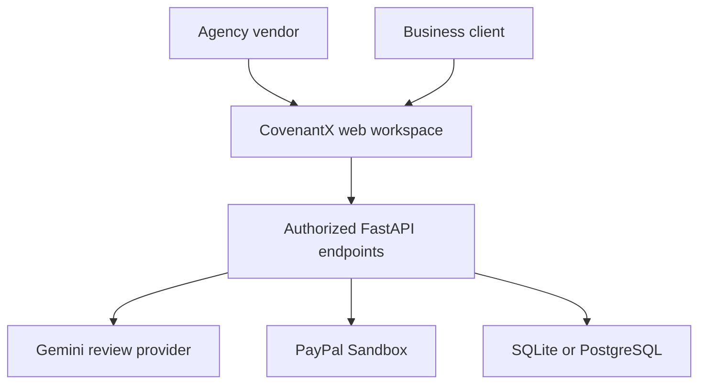
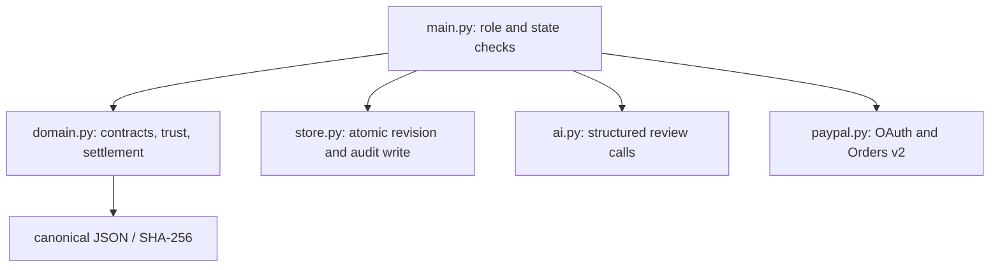
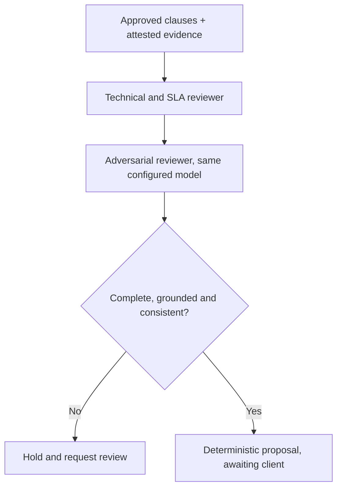
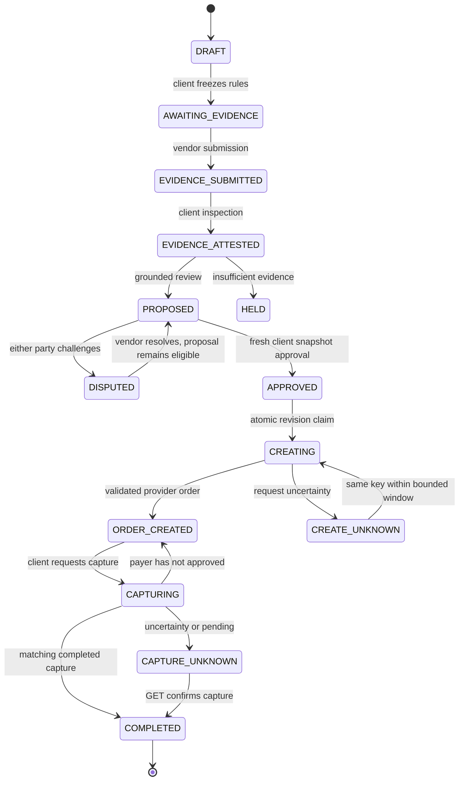
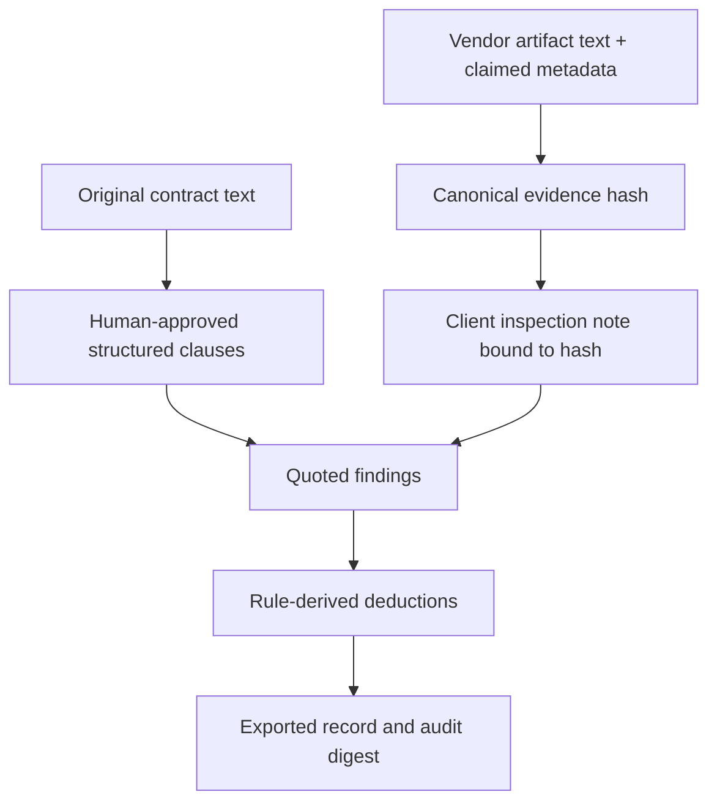
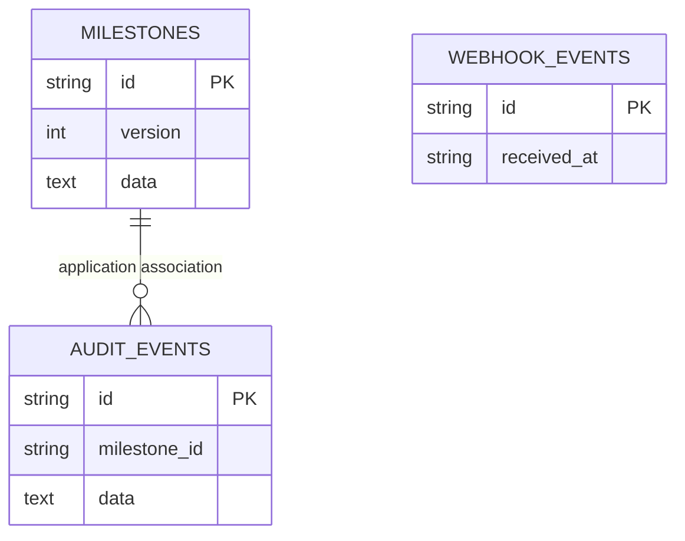

# Architecture

The implementation stores one versioned milestone aggregate plus separate audit and webhook-event tables. There is no external graph database, agent scheduler, queue or vector store.

## System context

## Implemented components

## AI orchestration

A typed Assessment is the output contract. Every finding needs an approved clause ID, pass/fail/unknown verdict, exact source quote and explanation. Missing IDs, duplicated IDs, unknown findings, absent citations, conflicts with attested metrics and reviewer concerns block eligibility. None of these controls establishes statistical accuracy or immunity to prompt injection.

## Financial state machine

PROVIDER_REVIEW is used for unfamiliar provider states. Before payment starts, new evidence invalidates verification, proposal and approval. Open disputes independently block settlement approval even if a subsequent verification returns PROPOSED. Payment states lock evidence and dispute mutation. A completed record cannot regress to a capture-eligible state.

## Evidence provenance

CovenantGraph is a derived relationship view over these stored records. It supports inspection, not a graph-query language. Artifact authenticity remains human-attested.

## Storage

The audit association is indexed, not a database foreign key. Audit events contain actor, timestamp, event, version and record hash. There is no write endpoint for audit rows, but a database administrator can modify them; there is no append-only storage guarantee. Backups, encryption at rest and administrative audit controls belong to deployment and have not been configured.

## Phase 2 extensions

`artifacts.py` parses original uploaded report text into derived evidence and per-file receipts. The vendor import endpoint persists the original bundle, derived evidence and provenance together, invalidating previous verification and approvals. `middleware.py` bounds streamed request bodies before parsing. The client can edit a DRAFT with a revision-bound contract endpoint; approved terms remain immutable.

`replay.py` reconstructs evidence from saved artifacts and recalculates settlement at the recorded verification timestamp. Both the authenticated API and offline passport CLI use it. It does not call Gemini, PayPal or a network source.

The recovery endpoint accepts an explicit order ID and note only for uncertain/interrupted states. After a two-minute grace period, it GETs provider state and applies the existing identity, amount, currency and snapshot validation. A record with a submitted capture, or a legacy uncertain provider-review state, cannot become capturable through recovery.
