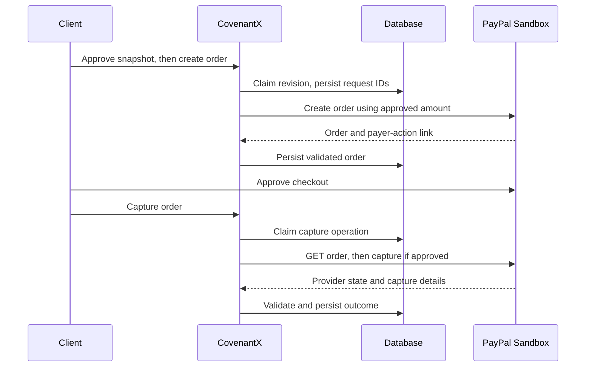

# PayPal integration

Status: implemented, adapter-tested with HTTPX MockTransport and workflow doubles; **real sandbox execution unverified**.

Source references (read 2026-11-08):
- https://developer.paypal.com/api/orders/v2
- https://developer.paypal.com/sdk/orders/v2/orders-create/
- https://developer.paypal.com/api/rest/integration/orders-api/api-use-cases/advanced/
- https://developer.paypal.com/api/rest/integration/orders-api

## Workflow

OAuth client credentials obtain an access token at `/v1/oauth2/token` on the hardcoded sandbox host. An approved server-side proposal supplies one purchase unit, its USD amount, milestone `reference_id`, and decision-snapshot `custom_id`. The browser never supplies a transaction amount. Create and capture use separately persisted UUID `PayPal-Request-Id` headers.

The returned order must match the milestone, snapshot, currency and amount. Only allowlisted HTTPS sandbox PayPal approval links reach the UI. The payer approves on PayPal. Before capture, the server GETs the order and requires APPROVED (or accepts a fully validated existing completion). A completion requires a matching order and exactly one COMPLETED capture with the expected amount/currency and a capture ID.

## Uncertainty and retries

Order creation errors conservatively become CREATE_UNKNOWN, including some definite provider rejections; this prioritizes avoiding accidental duplicates. Within five hours, reconciliation may resend the identical create request and key. The Orders create reference documents a default six-hour key retention; generic PayPal API pages mention other retention periods, so this integration uses the narrower endpoint-specific assumption. After the local retry window, an operator must inspect the merchant dashboard/provider records.

Capture timeout becomes CAPTURE_UNKNOWN. Reconciliation only retrieves provider state and never issues a second capture automatically. Pending captures remain blocked. A process crash in CREATING/CAPTURING is also blocked pending operator inspection. A client-only recovery API now supports an explicit candidate order ID and inspection note after a two-minute grace period. It only GETs the candidate, validates milestone, snapshot, currency and amount, and persists a matched result. If the candidate does not match, nothing is changed. Automatic leases/outbox recovery remain unimplemented. A durable capture-submitted marker preserves uncertainty across unfamiliar provider states; legacy PROVIDER_REVIEW records also cannot reopen capture.

Webhooks require configured webhook ID and provider-side signature verification at `/v1/notifications/verify-webhook-signature`. A verified event triggers GET reconciliation, not blind acceptance of a status in the event. The event ID is persisted after successful processing; retries are deduplicated. No source URL or certificate URL is fetched directly by this application.

This is checkout into the sandbox merchant account configured by the developer. It is not escrow, a marketplace vendor payout platform, or a refund engine. Chargebacks, refunds, partial captures, production onboarding and Payouts API are unimplemented.

## Acceptance still required

Use authorized sandbox credentials; successfully create one order; manually approve it with a sandbox buyer; capture; reconcile by GET; retain redacted order and capture receipts in a passport. Register and send a real signed webhook. These steps have not been performed in this package's build session.
